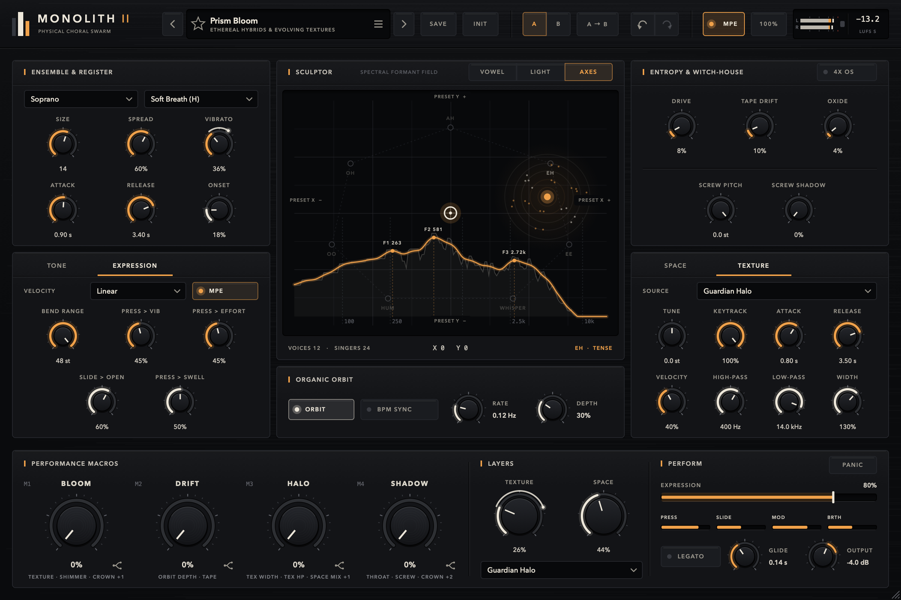
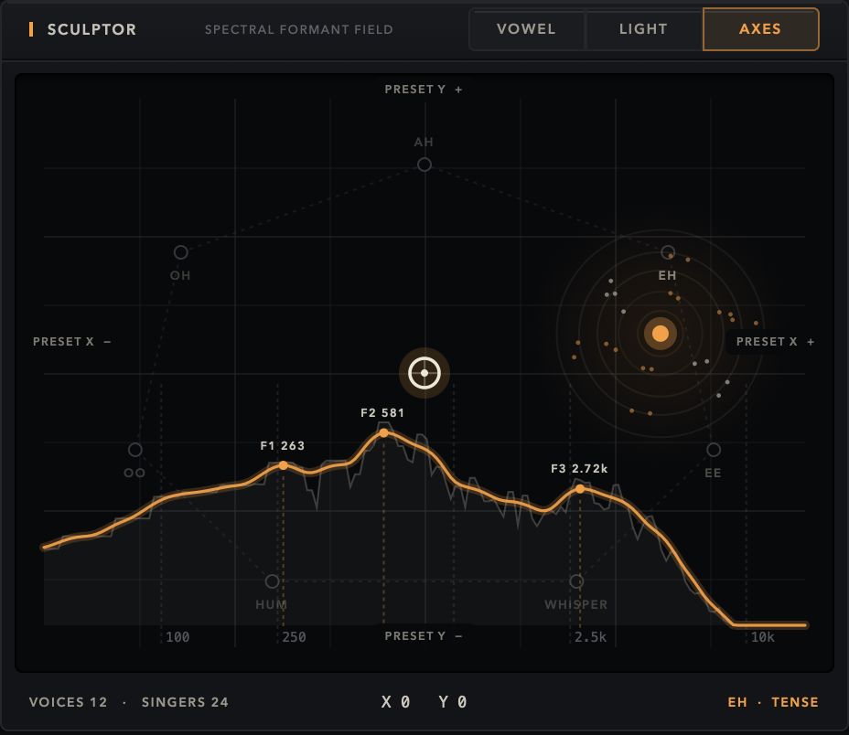
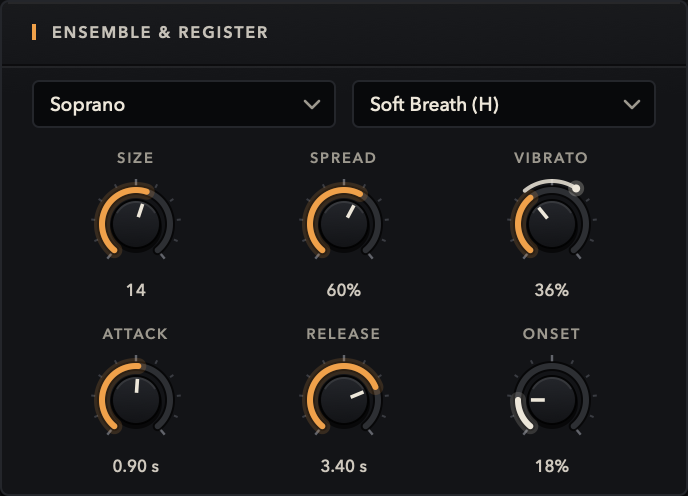
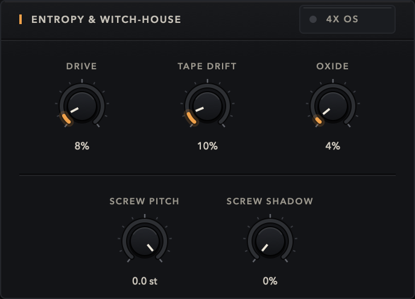
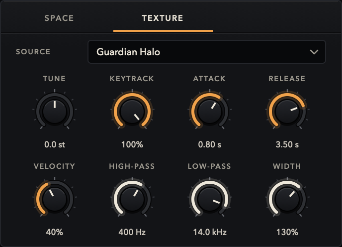
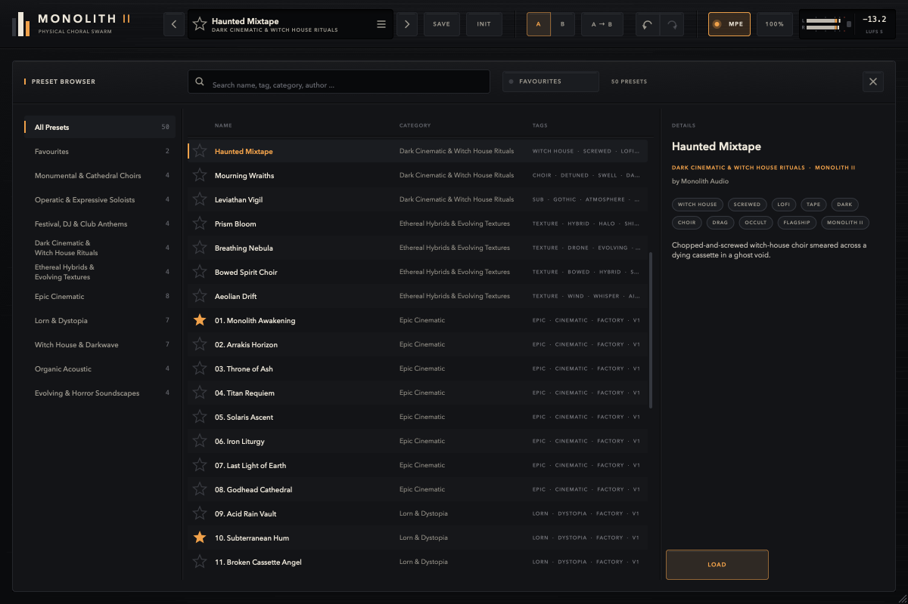
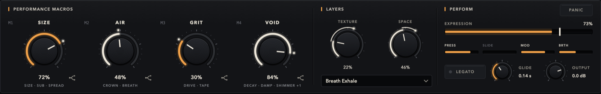

# MONOLITH II

**A choir synthesizer for cinematic, dark and ethereal music.** MONOLITH builds a choir out of up to 24 virtual singers, all generated in real time from models of the voice. Each singer has its own glottal source, vocal tract, vibrato and timing. You shape the choir's vowel and register, push it through tape and tube drive, and place it in a huge modelled space. A texture layer of original breath, air and choir sounds sits on top, and four performance macros reshape the whole sound at once. It runs as a VST3, AU (macOS) or standalone app.



## The synth

| | |
|---|---|
|  | **Sculptor.** A live formant display and XY pad. Drag through seven vowels (AH, OH, OO, EH, EE, HUM, WHISPER), or switch the pad to Light/Shadow or the preset's own two axes. |
|  | **Ensemble & Register.** Voice type (bass to soprano, or SATB auto), choir size, spread, vibrato, attack/release and consonant onsets. |
|  | **Entropy & Witch-House.** Per-voice tape and tube drive (with optional 4x oversampling), tape drift, oxide, and formant-preserving Screw Pitch and Screw Shadow. |
|  | **Space & Texture.** Four architectural reverbs with Spectral Freeze. The texture layer plays 8 original breath, air, choir and bowed sources, with tuning, envelope and filters. |
|  | **Preset browser.** 50 presets (30 classic + 20 MONOLITH II flagships) with search, categories, tags and favourites. Save your own. |



**Macros & Perform.** Four named macros per preset, each driving up to 8 parameters, with live modulation rings. Texture and space mixes, expression meters, glide, legato and output.

## Features

- Physical voice modelling: band-limited glottal excitation and 5-formant vocal tracts, 12-voice polyphony, up to 24 singers
- Vowel orbit: slow, BPM-syncable motion through the vowel field
- Sub-Abyss sub-octave and Spectral Crown upper-octave layers
- Per-voice tape/tube drive, wow and flutter, and Screw Pitch
- Brutalist reverb (Cathedral, Concrete Silo, Obsidian Abyss, Ghost Void) with click-free Spectral Freeze
- Texture layer of 8 original sources, synthesised from code with no third-party samples
- 4 macros × 8 routes, plus mod wheel, aftertouch, breath (CC2), CC74 and full **MPE**
- MIDI Learn (per preset or global), A/B compare, undo/redo, resizable UI (75–150 %)
- 50 presets, loudness-matched and tested at 44.1, 48 and 96 kHz

## Install

Download the build for your system from the [latest release](https://github.com/iisben/MONOLITH/releases/latest) (or build it yourself, below). Close your DAW, copy the files, then rescan plugins.

### macOS (11 or newer, Apple Silicon and Intel)
| File | Copy to |
|---|---|
| `MONOLITH.component` (AU) | `~/Library/Audio/Plug-Ins/Components/` |
| `MONOLITH.vst3` | `~/Library/Audio/Plug-Ins/VST3/` |
| `MONOLITH.app` (standalone) | `/Applications/` |

The build is not notarized yet. If macOS says it can't be opened, clear the download flag once:
```bash
xattr -dr com.apple.quarantine ~/Library/Audio/Plug-Ins/Components/MONOLITH.component ~/Library/Audio/Plug-Ins/VST3/MONOLITH.vst3 /Applications/MONOLITH.app
```

### Windows (10 or 11, 64-bit)
- Copy the `MONOLITH.vst3` folder to `C:\Program Files\Common Files\VST3\`.
- `MONOLITH.exe` is the standalone app and can live anywhere. Windows SmartScreen may warn because the build is unsigned; choose **More info → Run anyway**.

### Linux (x86_64, glibc 2.35 or newer, e.g. Ubuntu 22.04+)
- Copy the `MONOLITH.vst3` folder to `~/.vst3/`.
- Run the standalone `MONOLITH` binary from anywhere (`chmod +x MONOLITH` first if needed).
- It needs ALSA, FreeType, Fontconfig and X11, which desktop distros already include. JACK is optional.

User presets are saved to `~/Library/Audio/Presets/Monolith Audio/MONOLITH II` (macOS), `Documents\Monolith Audio\MONOLITH II\Presets` (Windows) or `~/.local/share/Monolith Audio/MONOLITH II/Presets` (Linux).

## Build from source

Requires CMake 3.22+, Ninja and a C++20 compiler. JUCE 8.0.15 is fetched automatically.

```bash
cmake -B build/release -G Ninja -DCMAKE_BUILD_TYPE=Release -DCMAKE_OSX_DEPLOYMENT_TARGET=11.0 -DCMAKE_OSX_ARCHITECTURES="arm64;x86_64"
cmake --build build/release --target MONOLITH_All
```

Plugins land in `build/release/MONOLITH_artefacts/Release/`. On Windows, use Visual Studio 2022 or the clang-cl cross toolchain in `cmake/toolchains/`. On Linux, install the dev packages listed in `Tools/linux/Dockerfile`, or run `Tools/build_linux_docker.sh`. Tests: `MonolithQA --phase v2.4`, `MonolithPresetQA` and `MonolithDspAudit`. `Tools/build_dist.sh` packages all three platforms from a Mac. Signal flow and threading are documented in [ARCHITECTURE.md](ARCHITECTURE.md).
